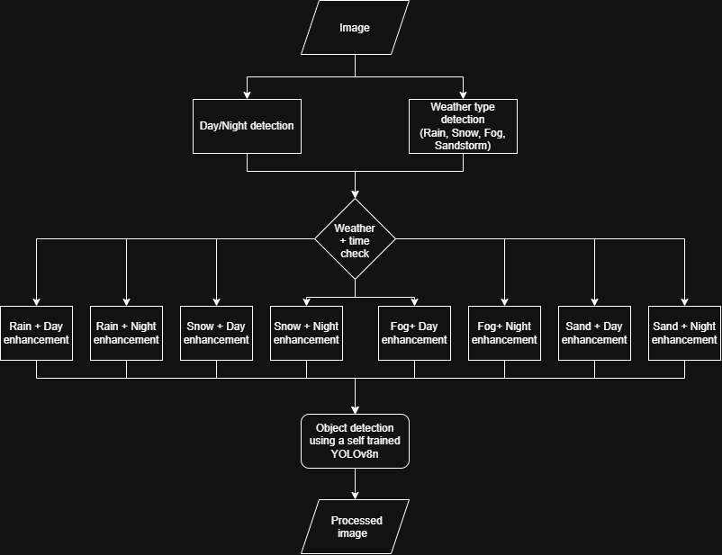

# Traffic Object Detection and Recognition under Adverse Weather Conditions (Fog, Rain, etc.)

## Project Description
A Python-based image processing application that uses CNNs and YOLOv8n architectures to detect and recognize objects in traffic under adverse weather conditions (Fog, Rain, etc.).

## State of the Art

Analysis of similar articles / applications / projects from the last 5 years.

|No.| Author(s) / Year | Title of the article / project | Application / Domain | Technologies used | Methodology / Approach | Results | Limitations | Additional comments |
|---|------------------|------------------------------------------------------------------------------------------|----------------------|-------------------|------------------------|---------|-------------|---------------------|
| 1 | Teena Sharma et al./2022 | Deep Learning-Based Object Detection and Scene Perception under Bad Weather Conditions | Autonomous Driving and road safety| Python, OpenCV, Google Colab cloud, YOLOv5, Roboflow | The YOLOv5 algorithm was pretrained with COCO weights and fine-tuned with Roboflow images (11 classes) for 100 epochs. The performance of the model was evaluated through a simulated video under normal weather conditions and rainy weather conditions.| precision=0.474, recall=0.337, mAP=0.258 | They evaluated the model using digitally simulated rain, not real life adverse weather conditions. Moreover, they didn't have many examples of all the labels (4 for traffic lights, 27 for bikers out of 1520 labels)| The algorithm is not trained on multiple weather conditions, the rain was digitally simulated. The algorithm should have been trained on multiple weather conditions and these conditions should not be simulated. Also, a bigger diveristy in labels would make a big difference. |
| 2 | Haodong Hu et al./2025 | YOLOv8-Based Multi-Object Detection Method for Adverse Weather Road Conditions | Autonomous Driving and road safety | PyTorch 1.9.0, Python 3.8, CUDA 11.8, 12 vCPU Intel(R) Xeon(R) Platinum 8352V CPU @ 2.10GHz, NVIDIA GeForce RTX 4090 with 24GB of VRAM, BotNet, LSKA, BIFPN/AWFPN, RTTS, DAWN | The architecture of the model YOLOv8 was improved so that it does not need preprocessing. At the end of the backbone (extracts the main features of an image) they added the BotNet module, which makes it possible for the model to not look only at a small number of neighboring pixels and decide what is there based on that, but take into consideration the global context. The next section is the neck section (combines small scale information with large scale information). Here it was added the LSKA module into the c2f block, which made it possible for bigger grids to be processed faster (from 7X7 to 1X7 and 7X1). In the head section (it is decided what each grid contains), it was replaced CSPNet with BiFPN, which gives more importance to maps with less noise. Also the training took place on the RTTS and DAWN datasets for 200 epochs.| precision=0.996, recall=0.7, mAP= 0.679| Only 2000 images were used, out of which 1250 images were depicting foggy weather conditions. The calculations also became much more complex and the GFLOPs rose from 8.9 to 20.6. | This paper presents a superior solution for our assignment.|
| 3 | Madhavi Kondapally et al./2024| Object Detection in Transitional Weather Conditions for Autonomous Vehicles| Autonomous Driving |AIWD6 dataset, Resnet50, Python 3.7, PyTorch, TensorFlow, GRL,DETR transformer, NVIDIA Tesla M60 GPU with 8GB of memory| They used ResNet50 for feature extraction, DAN with a GRL(gradient reversal layer) to remove weather distractions and then with the mSAT transformer they detected the objects. Also, the training took place for 50 epochs on 17,580 images with 8 classes. | mAP is around 50% for all classes| It uses bounding-boxes for object detection so it takes into consideration the pixels around the object too.| |
| 4 | Debasis Kumar and Naveed Muhammad /2021 | Object Detection in Adverse Weather for Autonomous Driving through Data Merging and YOLOv8 | YOLO8 Python Google Colab Roboflow | Resizing the images in the datasets ti 640x640 and 1280x1280. Training using Google Colab and Python to train YOLOv8 on 2715 training images, 720 validation images, 383 testing images. Tested 5 versions of images: original, 640x640 with augumantation, 640x640 without augumentation, 1280x1280 with augumenation and without  | the 1280x1280 images had a better mAP, the best being the one with augumentation and but the higher resoulution took longer to compute. The 640x640 augumented is a good middel road | | | |
| 5 |David Bettane, Gayatri Sanjay Gaikwad /2024| Robust Object Detection in Adverse Weather Conditions for Autonomous Vehicles | Autonomous vehicles | Python,PyTorch, OpenCV, NVIDIA Tesla A100 GPU | This application integrates Multi-Sensor Fusion (combines cameras, radars, LiDAR), Image Quality Enhancement (Neural networks such as FFA-Net are used to enhance images affected by adverse weather. This includes de-hazing, de-raining and de-snowing processes) and Dynamic Model Retraining. The BDD100K dataset was utilized, to expand its diversity and to simulate extreme weather conditions synthetic weather effects, image noise injection and image quality adjusments were added. The model was trained on a image size of 640X640 pixels for 50 epochs, the batch size was 60. | mAp: 1.0, precision: 1.0, Recall: 1.0 | High computational overhead, GAN-based augmenations occasionally introduced artifacts that confused detection models.| The results are too perfect and the adverse weather conditions were added. |

- **Application / Domain** – domain in which the described solution is applied (e.g., face recognition, augmented reality).
- **Technologies used** – technologies / hardware used in the project (e.g., OpenCV, TensorFlow, ZED stereo cameras).
- **Methodology / Approach** – description of the method used in the project.
- **Results** – main results obtained (metrics used for evaluation).
- **Limitations** – limitations encountered in research or implementation.
- **Additional comments** – observations on relevance to the current project; suggestions for improving the methodology.

## Proposed Architecture

### Components
## Context Classification
Once the image is received by the application, it will be analyzed to detect if it was taken during the day or night, also it will be evaluated to classify the weather condition (Fog, Rain, Snow etc.). 
## Dynamic Image Enhancement 
Based on the results of the initial evaluation, the image will be directed to one of the 8 specialized enhancement filters, which will normalize the image by mitigating the visual noise caused by that weather and lighting combination.

### Day/Night detection
Converting the image to HSV from RGB using OpenCV then averaging the V chanel to find the average. To find the threshold where we will make the decision between day and night we will use a similar approach as this [repository](https://github.com/arunnthevapalan/day-night-classifier) wich found a succes of 93.75% accuracy after only 200 images (100 for day and 100 for night)

### Wheather type detection
#### Rain
Converting the image to grayscale. We blur the image using a [Gauss filter](https://en.wikipedia.org/wiki/Gaussian_blur) to blur the image and lose the fine details then we substract the blured image from the normal image and we should de left with the noise in the image. Rain drops are usualy elongated vertical and we can use a vertical ege detection Kerenel to highlight the drops. The we binaarize the image and check the density of pixeles and decide if it is raining.

-[Source](https://www.mdpi.com/2076-3417/12/22/11628)

#### Snow
To detect snow we will average the V from the image and see if it is above a certain threshold that will be decided after some testing.

#### Fog
Images in foggy weather are usualy effected by bad contrast. The bad contrast detection is made calculating a the histogram and seeing if it is centered in a certain part. To enhance teh image we can equalize the histogram.

-[Source](https://publications.ri.cmu.edu/storage/publications/pub_files/pub4/narasimhan_srinivasa_g_2003_1/narasimhan_srinivasa_g_2003_1.pdf)

#### Sandstorme
Images taken in a sandstorme have similar features as images taken in foggy weather only a higher red/green level and a low blue level. To improve the image we will use a color-balancing method and equalizing the histogram for enhancing contrast.

-[Source](https://www.mdpi.com/2073-8994/14/11/2310)

## Object Detection
The enhanced image is given to a custom-trained YOLOv8n model. Considering that the image has been cleaned of the visual noise, the YOLO model will be able to perform real-time bounding box prediction and object recognition.
## Output
The final result is the image with the detection and recognition results. 